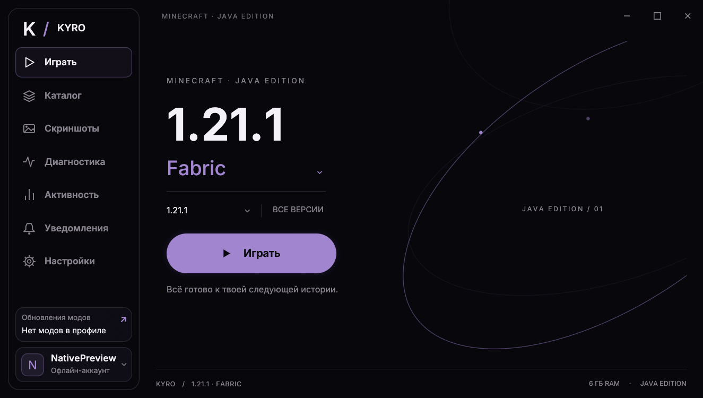

# KYRO Launcher

## Лицензия и исходный код

Copyright (c) 2026 slarenc. Код KYRO Launcher распространяется по [MIT](LICENSE).
Можно изучать, собирать, копировать, изменять и распространять код, в том числе
в коммерческих проектах, при сохранении текста лицензии и уведомления об авторстве.
Описание условий приложения: [APPLICATION_LICENSE.md](APPLICATION_LICENSE.md).
Сторонние компоненты сохраняют собственные лицензии:
[THIRD_PARTY_NOTICES.md](THIRD_PARTY_NOTICES.md).

KYRO — независимый проект, не связанный с Mojang или Microsoft и не одобренный ими.
Minecraft и другие товарные знаки принадлежат их правообладателям.

Неофициальный лаунчер Minecraft Java Edition для Windows x64 на **Rust + egui / eframe**. Чёрный интерфейс, встроенный Inter, палитра цветов и отдельные игровые профили.

**[Скачать KyroLauncher 0.7.2 для Windows x64](https://github.com/slarenc/kyro-launcher/releases/tag/v0.7.2)**

Нативный интерфейс на Rust + egui с оформлением Compact Plus. В версии 0.7.2 добавлены отмена подготовки Minecraft и надёжный возврат скрытого или свёрнутого окна после завершения игры. Сохраняются FPS-буст, Discord Rich Presence и установщик с ярлыком на рабочем столе. Программа в релизе называется KyroLauncher.exe.



## Возможности

- Выбор Vanilla, Fabric, Quilt, Forge и NeoForge в селекторе с названием текущего ядра.
- Автоматическая подготовка Minecraft и выбранного ядра. NeoForge устанавливается официальным установщиком с проверкой SHA-1.
- Подготовку к запуску можно отменить кнопкой «Отменить» на главном экране или в блоке прогресса. Проверенные скачанные файлы остаются в кэше; после запуска самой игры отмена подготовки недоступна.
- После завершения Minecraft окно лаунчера автоматически возвращается, в том числе после скрытия или сворачивания на время игры.
- Несколько офлайн-аккаунтов: добавление по нику, переключение, удаление и сохранение выбора.
- Поиск Modrinth с фильтрами версии и ядра; установка сборок .mrpack, модов, шейдеров и ресурспаков с проверкой файлов и обязательными зависимостями.
- Менеджер модов: включение, отключение, проверка и установка обновлений.
- FPS-буст на главном экране: подбор модов оптимизации под версию и ядро, просмотр списка и установка с зависимостями. Уже установленные моды пропускаются; настройки графики сохраняются.
- Подсветка FPS-буста цветом палитры при наличии включённых модов оптимизации в текущем профиле.
- Discord Rich Presence: состояние лаунчера или Minecraft с версией и ядром, адрес сервера из журнала игры, иконка KYRO и таймер с открытия лаунчера. Подключение уже настроено; достаточно запустить настольный Discord. В настройках доступны включение активности и показ адреса сервера.
- Автоматическая Java, диагностика вылетов, проверка совместимости модов, галерея скриншотов и пресеты графики с откатом.
- Календарь активности по дням, история сессий и статистика времени.
- Уведомления, настройки Java/RAM/JVM, палитра из девяти цветов и поведение окна при запуске игры.
- Раздельные папки EXE, данных лаунчера и игровых профилей.

## Запуск

Для установки с автоматическим ярлыком **KyroLauncher** на рабочем столе используйте `KyroLauncherSetup.exe`. Программа устанавливается для текущего пользователя без прав администратора; удаление программы сохраняет игровые данные. ZIP и отдельный EXE остаются переносными вариантами.

1. Скачайте ZIP из [Releases](https://github.com/slarenc/kyro-launcher/releases/latest) и распакуйте его.
2. Для Minecraft 1.21.1 установите **Java 21 x64**. Java также может быть автоматически загружена лаунчером. Интерфейс работает нативно через OpenGL; WebView2 не требуется.
3. Запустите EXE, откройте «Аккаунты» внизу меню и добавьте офлайн-аккаунт либо выполните Microsoft-вход.
4. Выберите версию Minecraft и ядро, затем нажмите **Играть**.

Для первоначальной загрузки и получения манифестов нужен интернет. Наличие офлайн-аккаунта не даёт доступа к серверам с проверкой лицензии.

Microsoft-вход необязателен и требует собственного OAuth Client ID с public client/device-code flow и доступом к Minecraft API. Пароль вводится на сайте Microsoft; токены сохраняются в Windows Credential Manager.

## Папки и данные

По умолчанию данные сохраняются в `%LOCALAPPDATA%\KyroLauncher`. Если рядом с EXE есть `data/state.json`, используется переносной режим с папкой `data`. Переменная `KYRO_DATA_DIR` позволяет указать другой каталог.

| Папка | Содержимое |
| --- | --- |
| Папка лаунчера | EXE приложения |
| Данные лаунчера | Настройки, аккаунты, история и общий кеш |
| `instances/<версия>-<ядро>` | Миры, моды и настройки выбранного профиля |

Каталог `.minecraft` официального лаунчера не изменяется. Личные данные и игровые файлы не входят в репозиторий и релиз.

## Сборка из исходников

Требуются Windows x64, Rust stable MSVC, Visual Studio Build Tools с компонентами C++ и Windows SDK.

```powershell
git clone https://github.com/slarenc/kyro-launcher.git
cd kyro-launcher
./build.ps1 -Mode check
./build.ps1 -Mode test
./build.ps1 -Mode release -OutputName 'KYRO Launcher.exe'
```

Готовый EXE появится в `dist`. Интерфейс, шрифт Inter и иконка встроены в EXE. Node.js и WebView не нужны.

Установщик собирается через Inno Setup 7 (или совместимый Inno Setup 6): `./build-installer.ps1`. Чтобы упаковать готовый `dist/KyroLauncher.exe`, используйте `./build-installer.ps1 -SkipBuild`. Результат: `dist/KyroLauncherSetup.exe`.

Исходники Rust находятся в `src-tauri/src` (историческое имя папки). `native_ui.rs` рисует экраны egui, `app_context.rs` связывает фоновые задачи и окно через канал событий. Minecraft, Modrinth, Java, диагностика и хранилище не зависят от оконного фреймворка. Старый веб-интерфейс в `ui` оставлен как архив дизайна и не включается в новую сборку.

Проверка нативного интерфейса с сохранением снимков всех экранов:

```powershell
./tools/native-smoke.ps1 -LauncherName 'KYRO Launcher.exe'
```

Тест использует отдельные данные в `target/native-ui-smoke`. Rust-тесты проверяют отрисовку экранов при 960 × 600, обработку устаревших ответов, совместимость модов, безопасные пути и сохранение игровых настроек. Старый `tools/ui-smoke.cjs` относится к архивному веб-интерфейсу.

### Восстановление Compact Plus

В нативной сборке восстановлена прежняя композиция: версия и запуск в левой колонке, наклонная орбита справа, боковая панель 198 px с аватаром, плоские вкладки, списки каталога с разделителями и собственные модальные окна. Inter встроен с отдельными начертаниями Medium, SemiBold и Bold. Настройки снова разделены на «Основные», «Java и память», «Загрузки» и «Профили графики».

Сборка: `./build.ps1 -Mode release -OutputName 'KYRO Launcher v0.7.0 Restored.exe'`. Проверка снимков: `./tools/native-smoke.ps1 -SkipBuild`. Тесты проверяют положение основных элементов и работу ползунка RAM с сохранением настройки.

## Новое в 0.7.0 Native

Весь интерфейс перенесён с Tauri/HTML на egui. Окно, селекторы, диалоги, палитра и галерея отрисовываются Rust-кодом. Сохранены офлайн-аккаунты и Microsoft device flow, пять ядер, установка Modrinth-сборок, зависимости и обновления модов, авто-Java, диагностика, календарь активности и пресеты графики с откатом. Загрузка файлов и запуск игры выполняются в Tokio отдельно от потока интерфейса. Старые `state.json` и каталоги профилей читаются без конвертации.

Проверка текущей сборки: **34 Rust-теста**, включая проверку расположения строк каталога с иконками; **15 нативных экранов и состояний** в отдельном тестовом каталоге. Microsoft-вход требует собственного Client ID и не проверялся в этой автоматической серии.

## Состояние версии 0.4

Проверены 11 Rust-тестов, официальные API, установка NeoForge 21.1.265, подготовка файлов Quilt/NeoForge и интерфейс готового EXE. Подтверждён офлайн-запуск Minecraft 1.21.1 Fabric. Полные игровые сессии Quilt/NeoForge и Microsoft-вход не проверялись в автоматических тестах.

Пока не реализованы английская локализация и синхронизация между компьютерами. Для шейдеров установите совместимый загрузчик шейдеров, например Iris. Статистика серверов отдельно не собирается; учитывается время процесса игры.

## Новое в версии 0.5

Добавлена собственная панель «Версии и ядра»: поиск по версии и ядру, группы релизов, бело-фиолетовые метки, даты из официального манифеста, фильтр подготовленных профилей и подготовка текущей версии кнопкой +. Подготовленные профили отмечаются после проверки файлов; учитываются успешные сессии прошлых версий. Список релизов кешируется локально.

Нативные выпадающие списки заменены меню KYRO на главном экране, в каталоге и в выборе года активности. Поддерживаются мышь, стрелки, Enter и Escape. Поиск сбрасывает прокрутку и показывает точное совпадение первым.

```powershell
./build.ps1 -Mode release -OutputName 'KYRO Launcher v0.7.0 Native.exe'
```

Исправлены высота строки названия ядра, интервалы в списке версий и переносы длинных надписей. Интерфейс проверен автоматическим UI-тестом; подготовка файлов и отметка скачанной версии проверены в готовом EXE.

## Установка сборок Modrinth (локальное обновление 0.5)

В каталоге «Сборки» выберите Minecraft и ядро, затем нажмите «Установить». Лаунчер загружает совместимый `.mrpack`, проверяет размер, SHA-1 и SHA-512 файлов, применяет общие и клиентские overrides и подготавливает Minecraft с точной версией загрузчика из сборки. Необязательные клиентские файлы включаются, серверные пропускаются. В 0.6 поддерживаются Vanilla, Fabric, Quilt, Forge и NeoForge.

Каждая версия сборки хранится в `instances/modpacks/<проект>-<версия>`. Обычные профили, миры и конфиги других сборок не затрагиваются. Незавершённая установка не попадает в список установленных сборок. Повторная установка уже готовой версии выбирает её без перезаписи файлов игрока.

После установки профиль выбран на главном экране: нажмите PLAY. В разделе «Установленные» и в каталоге у готовой сборки доступна кнопка «Запустить». Выпадающее меню «Игровой профиль» переключает сборки и обычный профиль. Дополнительные моды устанавливаются в выбранный профиль.

Формат: [официальная спецификация Modrinth](https://support.modrinth.com/en/articles/8802351-modrinth-modpack-format-mrpack).

Проверено: 13 Rust-тестов (ещё 3 сетевых теста пропущены), UI-сценарии успешной и неудачной установки, выбор и запуск профиля. В готовом EXE установлена Fabulously Optimized 6.5.0 для Minecraft 1.21.1: 48 модов, Fabric 0.19.3 из манифеста. Подтверждён запуск до главного меню и штатное завершение с кодом 0; проверены повторная установка без перезаписи файла игрока и раздельные папки профилей.

## Локальное обновление 0.6

- **Forge**: выбор в меню ядер, каталог Modrinth, установка сборок и подготовка клиента официальным установщиком с проверкой SHA-1. Для обычного профиля выбирается рекомендованная версия Forge (или latest), для сборки — точная версия из `.mrpack`.
- **Автоматическая Java**: при подготовке Minecraft выбирается нужная основная версия Java. При необходимости Temurin JRE для Windows x64 скачивается с Adoptium, проверяется по SHA-256 и распаковывается в `runtimes` внутри данных KYRO. Системная Java не меняется. Режим можно выключить в «Java и память» и указать путь вручную; там же есть явная кнопка установки.
- **Менеджер модов**: «Каталог → Мои моды» сканирует реальные JAR-файлы выбранного профиля, включая сборки. Выключение переименовывает файл в `.jar.disabled`. Проверка Modrinth распознаёт версии по SHA-1, показывает обязательные зависимости и доступные обновления. Перед заменой старые JAR сохраняются в `mod-backups`, состояние выключенных модов сохраняется.
- **Главный экран**: «Настройки → Основные» позволяет выбрать орбитальную композицию или карточку, загрузить собственный PNG/JPEG/WebP до 4 МБ и назначить обложку выбранной сборке. Изображения сохраняются локально в настройках.
- **Обновления KYRO**: проверка последнего публичного релиза `slarenc/kyro-launcher` при запуске и вручную в настройках. Более новый EXE загружается по HTTPS и сверяется с SHA-256 из GitHub Release Assets API. Отдельный помощник заменяет EXE после закрытия приложения, сохраняет прежний EXE и перезапускает лаунчер с тем же каталогом данных. Релизы без SHA-256 не устанавливаются автоматически.

Сборка: `./build.ps1 -Mode release -OutputName 'KYRO Launcher v0.6.exe'`. Публичная ссылка выше относится к последнему опубликованному релизу; локальное обновление не публикуется автоматически.

Проверено в 0.6: 18 Rust-тестов, UI-сценарии всех пяти функций, настоящая установка Temurin 21, переключение JAR-мода и обновление BetterGrassify с резервной копией. Помощник обновления проверен заменой EXE, перезапуском и сохранением тестовых настроек и каталога данных. Forge 52.1.20 установлен официальным установщиком; Minecraft 1.21.1 запущен с управляемой Java и закрыт штатно (77 секунд, код 0).

## Обновление 0.6.1

Добавлены разделы «Серверы», «Скриншоты» и «Диагностика». Серверы сохраняются в избранном, статус читается напрямую по Minecraft Server List Ping (игроки, версия, время ответа); подключение запускает выбранный профиль с адресом сервера. Поддерживаются явные порты и IPv6, DNS SRV пока не разрешается автоматически. Галерея читает только PNG из `screenshots` выбранного профиля и открывает увеличенный просмотр.

Результат каждого запуска и хвост лога сохраняются в `kyro-diagnostics` внутри игрового профиля. Диагностика ищет явные сигнатуры ошибок Java, RAM, зависимостей, Mixin, графики и файлов. Старый лог другого профиля не используется; успешный запуск не объявляется вылетом из-за предупреждений в логе.

Локальная проверка совместимости читает Fabric/Quilt JSON и Forge/NeoForge TOML, учитывает вложенные JAR, обязательные зависимости, ограничения версии Minecraft и явные конфликты. Неизвестные ограничения остаются предупреждениями. Перед запуском явные ошибки показываются в диалоге с ручным продолжением. Путь: «Каталог → Мои моды → Проверить совместимость».

Три профиля графики расположены в «Настройки → Профили графики». Применение сохраняет исходный `options.txt`, меняет только перечисленные графические параметры и поддерживает точный откат. Клавиши, звук и другие параметры остаются прежними. Профили применяются отдельно к каждому игровому профилю.

Сборка: `./build.ps1 -Mode release -OutputName 'KYRO Launcher v0.6.1.exe'`.

Проверено в 0.6.1: 27 Rust-тестов, UI-сценарии галереи, серверов, диагностики, пресетов и диалога совместимости (отмена и ручное продолжение). Настоящая сборка с 48 JAR проверена без ошибок и предупреждений; ошибочный JAR обнаружен. В готовом EXE проверены точный откат графики, PNG, ошибка Java и запросы статуса сервера. Minecraft передал handshake/login локальному тестовому серверу и завершился штатно с кодом 0; загрузка мира на тестовом сервере не проверялась.

### Обновление интерфейса 0.6.1

В актуальном компактном варианте вкладка «Серверы» убрана, стартовое окно уменьшено до 1060 × 600 (минимум 960 × 600). Пункты меню расположены с фиксированными небольшими промежутками, аккаунт закреплён снизу. Главный экран адаптирован под малую высоту, длинные страницы прокручиваются. Увеличены мелкие подписи. Кнопка запуска переведена на «Играть», её цвет, подсветка меню, орбиты, плашки и календарь активности следуют выбранной палитре. Проверены сценарии интерфейса при стартовом и минимальном размерах.

Сборка: `./build.ps1 -Mode release -OutputName 'KYRO Launcher v0.6.1 UI.exe'`.

### Карточка обновлений модов

В компактном интерфейсе под меню отображается фактическое число обновлений модов выбранного профиля. Карточка использует проверку Modrinth по хешам, открывает менеджер модов и обновляется после установки и обновления файлов. Кеш действует пять минут отдельно для каждого профиля; старые ответы фоновых запросов не перезаписывают результаты новой проверки. При ошибке сети показывается состояние «Не удалось проверить». Блок аккаунта имеет скруглённую рамку и фон.

Сборка: `./build.ps1 -Mode release -OutputName 'KYRO Launcher v0.6.1 Compact Plus.exe'`.

## Сторонние компоненты

Inter Variable 4.1 распространяется по SIL Open Font License. Текст лицензии включён в `ui/fonts/OFL.txt` и в Windows-релиз. Подробнее: [THIRD_PARTY_NOTICES.md](THIRD_PARTY_NOTICES.md).
