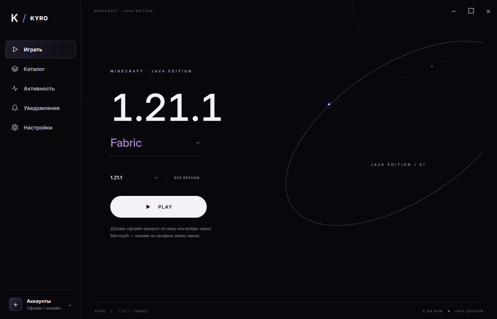

# KYRO Launcher

Неофициальный лаунчер Minecraft Java Edition для Windows x64 на **Rust + Tauri 2**. Чёрный интерфейс, встроенный Inter, палитра цветов и отдельные игровые профили.

**[Скачать версию 0.5.0 для Windows](https://github.com/slarenc/kyro-launcher/releases/tag/v0.5.0)**



## Возможности

- Выбор Vanilla, Fabric, Quilt и NeoForge в селекторе с названием текущего ядра.
- Автоматическая подготовка Minecraft и выбранного ядра. NeoForge устанавливается официальным установщиком с проверкой SHA-1.
- Несколько офлайн-аккаунтов: добавление по нику, переключение, удаление и сохранение выбора.
- Поиск Modrinth с фильтрами версии и загрузчика; установка модов, шейдеров и ресурспаков, обязательные зависимости модов.
- Календарь активности по дням, история сессий и статистика времени.
- Уведомления, настройки Java/RAM/JVM, палитра из девяти цветов и поведение окна при запуске игры.
- Раздельные папки EXE, данных лаунчера и игровых профилей.

## Запуск

1. Скачайте ZIP из [Releases](https://github.com/slarenc/kyro-launcher/releases/latest) и распакуйте его.
2. Для Minecraft 1.21.1 установите **Java 21 x64**. Окну лаунчера нужен **Microsoft Edge WebView2 Runtime**.
3. Запустите EXE, откройте «Аккаунты» внизу меню и добавьте офлайн-аккаунт либо выполните Microsoft-вход.
4. Выберите версию Minecraft и ядро, затем нажмите **PLAY**.

Для первоначальной загрузки и получения манифестов нужен интернет. Наличие офлайн-аккаунта не даёт доступа к серверам с проверкой лицензии.

Microsoft-вход необязателен и требует собственного OAuth Client ID с public client/device-code flow и доступом к Minecraft API. Пароль вводится на сайте Microsoft; токены сохраняются в Windows Credential Manager.

## Папки и данные

По умолчанию данные сохраняются в `%LOCALAPPDATA%\KyroLauncher`. Если рядом с EXE есть `data/state.json`, используется переносной режим с папкой `data`. Переменная `KYRO_DATA_DIR` позволяет указать другой каталог.

| Папка | Содержимое |
| --- | --- |
| Папка лаунчера | EXE приложения |
| Данные лаунчера | Настройки, аккаунты, история и общий кеш |
| `instances/<версия>-<ядро>` | Миры, моды и настройки выбранного профиля |

Каталог `.minecraft` официального лаунчера не изменяется. Личные данные и игровые файлы не входят в репозиторий и релиз.

## Сборка из исходников

Требуются Windows x64, Rust stable MSVC, Visual Studio Build Tools с компонентами C++ и Windows SDK.

```powershell
git clone https://github.com/slarenc/kyro-launcher.git
cd kyro-launcher
./build.ps1 -Mode check
./build.ps1 -Mode test
./build.ps1 -Mode release -OutputName 'KYRO Launcher v0.5.exe'
```

Готовый EXE появится в `dist`. HTML/CSS/JavaScript из `ui` встраиваются Tauri в приложение; Node.js для сборки и запуска лаунчера не нужен.

Опциональная проверка интерфейса:

```powershell
npm install
npm run test:ui
```

UI-тест использует установленный Microsoft Edge и тестовый IPC bridge. Сетевые Rust-тесты, включая официальный установщик NeoForge в отдельной тестовой папке:

```powershell
./build.ps1 -Mode test -NetworkTests
```

## Состояние версии 0.4

Проверены 11 Rust-тестов, официальные API, установка NeoForge 21.1.265, подготовка файлов Quilt/NeoForge и интерфейс готового EXE. Подтверждён офлайн-запуск Minecraft 1.21.1 Fabric. Полные игровые сессии Quilt/NeoForge и Microsoft-вход не проверялись в автоматических тестах.

Пока не реализованы импорт сборок `.mrpack`, Forge, английская локализация, синхронизация и автообновление самого лаунчера. Сборки Modrinth доступны для просмотра. Для шейдеров установите совместимый загрузчик шейдеров, например Iris. Статистика серверов отдельно не собирается; учитывается время процесса игры.

## Новое в версии 0.5

Добавлена собственная панель «Версии и ядра»: поиск по версии и ядру, группы релизов, бело-фиолетовые метки, даты из официального манифеста, фильтр подготовленных профилей и подготовка текущей версии кнопкой +. Подготовленные профили отмечаются после проверки файлов; учитываются успешные сессии прошлых версий. Список релизов кешируется локально.

Нативные выпадающие списки заменены меню KYRO на главном экране, в каталоге и в выборе года активности. Поддерживаются мышь, стрелки, Enter и Escape. Поиск сбрасывает прокрутку и показывает точное совпадение первым.

```powershell
./build.ps1 -Mode release -OutputName 'KYRO Launcher v0.5.exe'
```

Исправлены высота строки названия ядра, интервалы в списке версий и переносы длинных надписей. Интерфейс проверен автоматическим UI-тестом; подготовка файлов и отметка скачанной версии проверены в готовом EXE.

## Сторонние компоненты

Inter Variable 4.1 распространяется по SIL Open Font License. Текст лицензии включён в `ui/fonts/OFL.txt` и в Windows-релиз. Подробнее: [THIRD_PARTY_NOTICES.md](THIRD_PARTY_NOTICES.md).
